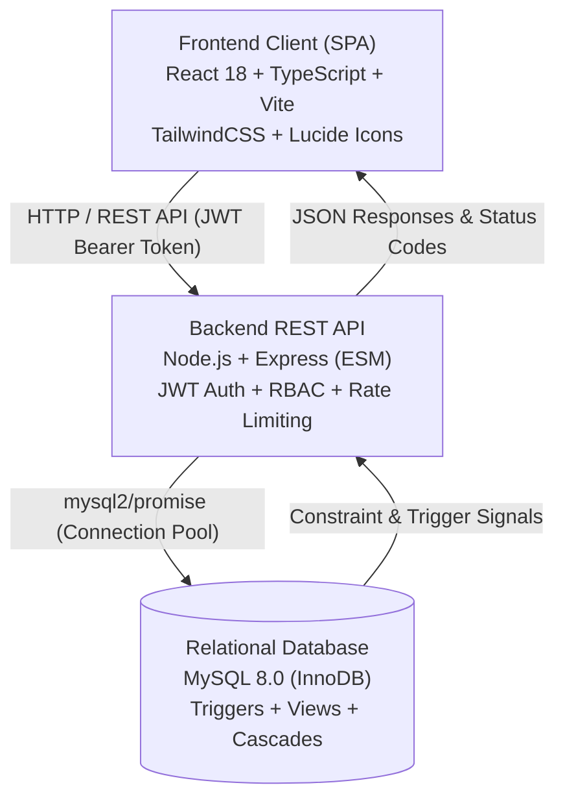
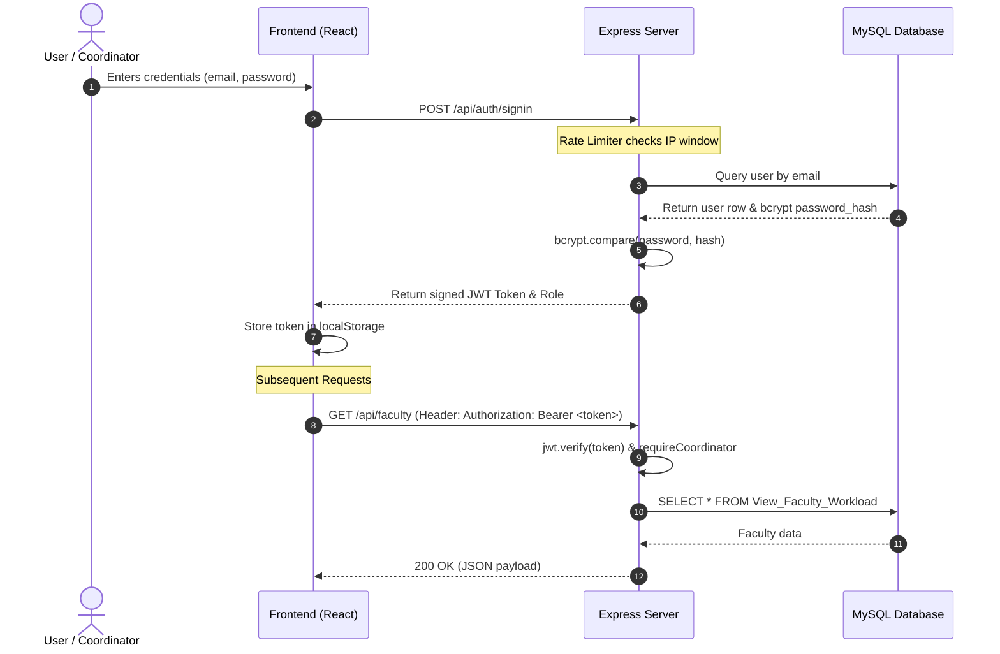

# CLUS — Technology Stack & Architecture Documentation

> **Classroom & Lab Utilization Optimization System (CLUS)**  
> Comprehensive technical reference detailing all languages, frameworks, libraries, database engines, security protocols, and development tooling powering the platform.

---

## 1. System Architecture Overview

CLUS is built as a modern, decoupled **Single Page Application (SPA)** architecture paired with a **RESTful micro-backend** and an **ACID-compliant relational database** fortified with stored server-side business rules.



---

## 2. Frontend Technology Stack

| Technology / Library | Version | Category | Purpose & Usage in Codebase |
| :--- | :---: | :--- | :--- |
| **React** | `^18.3.1` | UI Library | Core component-based reactive user interface, utilizing functional components and hooks (`useState`, `useEffect`, `useMemo`, `useCallback`). |
| **TypeScript** | `^5.5.3` | Programming Language | Strict static typing, type definitions for all models (`Faculty`, `Course`, `TimeSlot`, `Room`, `Batch`, `Schedule`), eliminating runtime type errors. |
| **Vite** | `^5.4.2` | Build Tool & Dev Server | Ultra-fast Hot Module Replacement (HMR), Rollup-based production bundling, optimized asset delivery. |
| **React Router DOM** | `^7.13.2` | Client-Side Routing | Declarative SPA routing managing application views (`/`, `/app`, `/login`, tab-based deep links). |
| **TailwindCSS** | `^3.4.1` | CSS Framework | Utility-first styling engine used for responsive grid layouts, color palettes, micro-animations, and glassmorphic panels. |
| **PostCSS** & **Autoprefixer** | `^8.4.35` / `^10.4.18` | CSS Processing | Automatic vendor prefixing and CSS parsing for cross-browser compatibility. |
| **Lucide React** | `^0.344.0` | Iconography | Lightweight, accessible SVG icon set (e.g. `GraduationCap`, `Calendar`, `Building2`, `Users`, `BookOpen`, `Layers`, `Clock`). |
| **pdf-parse** | `^2.4.5` | Document Utility | Parsing and processing PDF schedule data and academic syllabus documents. |
| **Fetch API (Native)** | Built-in | Network Layer | Encapsulated in [`src/lib/api.ts`](file:///d:/Shahzaad/Projects/College/classroomUtilOpSystem/src/lib/api.ts) via `authFetch`, handling automatic JWT authorization headers, status validation, and error propagation. |

---

## 3. Backend Technology Stack

| Technology / Library | Version | Category | Purpose & Usage in Codebase |
| :--- | :---: | :--- | :--- |
| **Node.js** | `>=20.x` (v22 ESM) | Runtime Environment | High-performance asynchronous event-driven JavaScript engine running backend server services. |
| **Express.js** | `^4.19.2` | Web Framework | REST API routing, request parsing, controller management, and middleware orchestration. |
| **MySQL2** | `^3.9.7` | Database Driver | High-speed MySQL client supporting connection pooling (`createPool`), parameterized SQL queries, and promise-based transactions. |
| **JSON Web Token (`jsonwebtoken`)** | `^9.0.3` | Authentication | Cryptographically signed bearer tokens (`HS256`) encoding user identity and authorization claims with token expiration. |
| **bcryptjs** | `^3.0.3` | Password Hashing | One-way salted hashing (10 salt rounds) for administrative user passwords, resistant to rainbow table and brute-force attacks. |
| **express-rate-limit** | `^8.7.2` | Security Middleware | Rate-limiting IP requests on sensitive authentication endpoints (`/api/auth/signin`) to thwart brute-force and DoS attempts. |
| **CORS (`cors`)** | `^2.8.5` | Cross-Origin Security | Whitelist-based origin validation allowing authorized frontend origins (`http://localhost:5174`) while rejecting rogue domains. |
| **dotenv** | `^16.4.5` | Environment Configuration | Secure runtime environment variables management (`DB_HOST`, `DB_PORT`, `DB_USER`, `DB_PASSWORD`, `PORT`, `JWT_SECRET`). |

---

## 4. Database & Persistence Layer

| Component | Technology | Specification & Implementation Details |
| :--- | :--- | :--- |
| **Database Engine** | **MySQL 8.0+** | ACID-compliant relational store utilizing the **InnoDB** storage engine for row-level locking, foreign key integrity, and crash recovery. |
| **Character Set** | `utf8mb4` | Full Unicode support including international characters and academic designations. |
| **Connection Strategy** | **Connection Pooling** | Managed by `mysql2/promise` with configurable connection caps (`connectionLimit: 10`), connection recycling, and keep-alive pings. |
| **Integrity Constraints** | Foreign Keys & Cascades | `ON DELETE CASCADE` on child entities (courses, batches), `ON DELETE SET NULL` on audit references, preventing orphaned records. |
| **Domain Constraints** | `CHECK` Constraints | Enforces domain rules at schema level (`year_of_study BETWEEN 1 AND 4`, `capacity > 0`, `student_count > 0`, `room_type IN (...)`, `hour_order BETWEEN 1 AND 10`, `slot_type IN ('Theory', 'Lab')`). |
| **Compound Uniques** | Unique Keys | Composite uniqueness guarantees such as `UNIQUE(year_of_study, section, dept_id)` preventing duplicate student cohorts. |

### Stored Database Triggers (Server-Side Invariants)
- **`trg_prevent_booking_conflict`** (`BEFORE INSERT ON Course_Schedule`):
  1. Room double-booking prevention.
  2. Batch scheduling collision prevention.
  3. Faculty simultaneous booking prevention.
  4. Room capacity vs. batch student count verification.
  5. 8–4 vs 9–5 faculty shift span rule (Hour 1 vs Hour 10 on the same day).
  6. Course taxonomy room & slot compatibility (`...T` $\rightarrow$ Theory & Classroom, `...P` $\rightarrow$ Lab & Lab rooms, `...J` $\rightarrow$ Joint).
  7. Course-Batch whole-semester faculty invariance.
- **`trg_check_schedule_update`** (`BEFORE UPDATE ON Course_Schedule`): Enforces identical conflict checks during in-place record modifications.
- **`trg_protect_room_capacity_on_update`** (`BEFORE UPDATE ON Room`): Blocks lowering room capacity below existing scheduled batch sizes.
- **`trg_protect_batch_size_on_update`** (`BEFORE UPDATE ON Batch`): Blocks expanding batch student size beyond assigned room limits.

### SQL Analytical Views
- **`View_Detailed_Schedule`**: Full 8-table relational join providing denormalized schedule data with instructors and audit metadata.
- **`View_Faculty_Workload`**: Dynamic aggregation computing assigned slots, remaining quota, and utilization percentage.
- **`View_Room_Utilization`**: Room allocation efficiency and total active slot count.
- **`View_Wasted_Capacity`**: Quantifies unused room capacity during active lectures.

---

## 5. Security & Authentication Architecture



- **Authentication Protocol**: Stateless JSON Web Tokens (JWT) with bearer authorization header transmission.
- **Role-Based Access Control (RBAC)**:
  - **`coordinator`**: Full administrative privileges — provisioning staff, creating/editing/deleting courses, batches, rooms, faculty, and schedule allocations.
  - **`viewer`**: Read-only observational access with UI mutation controls hidden and server-side HTTP 403 Forbidden enforcement on write routes.
- **Rate Limiting**: Defends authentication endpoints against brute force attacks using sliding window counters.
- **SQL Injection Prevention**: 100% of database interactions utilize parameterized prepared statements (`?` placeholders).

---

## 6. Code Quality, Linting & Testing Framework

| Area | Tool / Framework | Configuration & Scope |
| :--- | :--- | :--- |
| **Static Typing** | TypeScript (`tsc`) | Strict type checking via `tsconfig.app.json` with `npx tsc --noEmit`. |
| **Code Linting** | ESLint v9 (`flat config`) | Rules from `@eslint/js`, `typescript-eslint`, and React Hooks plugin ensuring idiom correctness and dead-code prevention. |
| **API & DB Testing** | Node.js Test Suites (`.cjs`) | Custom lightweight integration test suites (`test_faculty.cjs`, `test_sprint4.cjs`, `test_sprint3.cjs`, `test_sprint2.cjs`) executing real HTTP requests and direct DB trigger asserts. |
| **UI Verification** | Headless Browser Automation | In-browser validation of layout rendering, interactive modals, responsive grid viewports, and color-coded status badges. |

---

## 7. Directory Structure & Technology Mapping

```
classroomUtilOpSystem/
├── database/                     # MySQL Database Layer
│   ├── schema.sql                # DDL: Tables, constraints, views, triggers
│   ├── seed.sql                  # DML: Master seed dataset (50 slots, faculty, rooms)
│   ├── reset_seed.cjs            # Automated database reset script
│   └── apply_faculty_schema.cjs  # Schema migration runner
├── server/                       # Backend Application Layer (Node.js + Express)
│   ├── index.js                  # Express API server, routes, middleware, controller logic
│   ├── validation.js             # Schema validation rules (9-char courses, faculty, shifts)
│   ├── package.json              # Backend dependencies
│   └── .env.example              # Environment variables template
├── src/                          # Frontend Application Layer (React + TypeScript)
│   ├── components/               # UI Components
│   │   ├── DashboardLayout.tsx   # Top navigation, role badges, sidebar, tab coordinator
│   │   ├── FacultyList.tsx       # Faculty roster, workload progress, timetable modal
│   │   ├── ScheduleView.tsx      # Master timetable, allocation forms, clubbed booking
│   │   ├── TimeSlotGrid.tsx      # Interactive 10-period cross-week slot matrix
│   │   ├── CourseList.tsx        # Course catalog with 9-character T/P/J type badges
│   │   ├── RoomList.tsx          # Room inventory & capacity manager
│   │   ├── BatchList.tsx         # Student cohort & department manager
│   │   ├── DepartmentList.tsx    # Academic department manager
│   │   ├── AnalyticsView.tsx     # Utilization analytics, wasted capacity metrics
│   │   └── CascadeDeleteModal.tsx# Deletion impact assessment modal
│   ├── contexts/                 # React Context Providers
│   │   └── AuthContext.tsx       # Authentication state, login, logout, role exposure
│   ├── lib/                      # Core Utilities
│   │   └── api.ts                # Typed API client with authFetch wrapper
│   ├── App.tsx                   # Application entry router
│   ├── index.css                 # Custom design tokens, glassmorphism, animations
│   └── main.tsx                  # React DOM root render
├── package.json                  # Root & Frontend package manifest
├── vite.config.ts                # Vite build and dev server configuration
├── tailwind.config.js            # Tailwind styling tokens and breakpoints
└── Tech_Stack.md                 # Complete technology stack documentation
```
