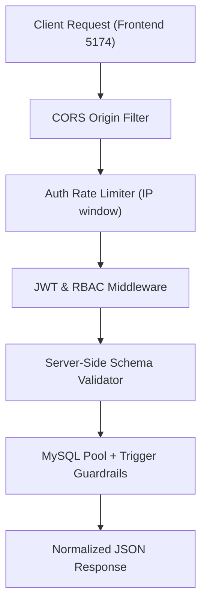

# Implementation Plan — Sprint 4: Pilot Hardening

Sprint 4 hardens the Classroom & Lab Utilization System (CLUS) for pilot readiness, focusing on security, API rate limiting, robust server-side input validation, error message normalization, and database connection safety.

---

## 1. Objectives & Scope

Per [CLUS_development_spec.md](file:///d:/Shahzaad/Projects/College/classroomUtilOpSystem/CLUS_development_spec.md#sprint-4--pilot-hardening):
1. **Restrict CORS**:
   - Replace open wildcard `app.use(cors())` with explicit origin white-listing (`http://localhost:5174`, `http://127.0.0.1:5174`, configurable via `.env`).
2. **Authentication Rate Limiting**:
   - Install and configure `express-rate-limit` on `/api/auth/*` routes (e.g., maximum 10 attempts per 15 minutes per IP) to mitigate brute-force attempts.
3. **Server-Side Input Validation Ahead of DB**:
   - Validate request payloads before reaching MySQL queries or triggers, returning immediate, clean `400 Bad Request` messages for:
     - Negative or non-numeric capacities (`capacity <= 0`).
     - Invalid room types (allowed: `'Classroom'`, `'Lab'`, `'Lecture Hall'`).
     - Invalid batch sections (must be single uppercase letter `A-Z`) and year of study (`1-5`).
     - Malformed emails and weak passwords on staff provisioning.
     - Empty, out-of-range, or non-numeric IDs.
4. **Error Normalization & Safe Connection Pool**:
   - Prevent raw SQL stack traces from leaking to client responses.
   - Verify connection release on all routes (e.g., `evaluate_room_usage` / `trapped-capacity`).
   - Add a lightweight system health check endpoint: `GET /api/health`.

---

## 2. Proposed Architecture & File Changes



### Files to Modify / Create

| Component | Path | Proposed Changes |
|-----------|------|------------------|
| **Dependencies** | `server/package.json` | Add `express-rate-limit` dependency. |
| **Environment** | `server/.env`, `server/.env.example` | Add `ALLOWED_ORIGINS=http://localhost:5174,http://127.0.0.1:5174`. |
| **Validation Layer** | `server/validation.js` *(new)* | Modular validation schemas & middlewares for Room, Batch, Course, Schedule, User inputs. |
| **Backend Core** | `server/index.js` | Restrict CORS, attach `authLimiter`, mount validation middlewares on `POST`/`PUT` routes, add `/api/health`. |
| **Test Suite** | `test_sprint4.cjs` *(new)* | Comprehensive automated test suite validating CORS rejection, rate limiter trigger, input validation 400 errors, and health check. |

---

## 3. Detailed Implementation Steps

### Step 1: Install `express-rate-limit` in Server
```bash
npm install express-rate-limit --prefix server
```

### Step 2: Configure Environment Variables
Update [server/.env](file:///d:/Shahzaad/Projects/College/classroomUtilOpSystem/server/.env) and `server/.env.example`:
```ini
ALLOWED_ORIGINS=http://localhost:5174,http://127.0.0.1:5174
```

### Step 3: Implement Input Validation Middleware (`server/validation.js`)
Create standalone, testable validation functions:
- `validateRoom(req, res, next)`:
  - `room_number`: string, 1–20 alphanumeric/hyphens.
  - `room_type`: strictly in `['Classroom', 'Lab', 'Lecture Hall']`.
  - `capacity`: integer between `1` and `1000`.
- `validateBatch(req, res, next)`:
  - `batch_id`: positive integer (for creation).
  - `year_of_study`: integer between `1` and `5`.
  - `section`: single uppercase alphabet letter (`/^[A-Z]$/`).
  - `student_count`: integer between `1` and `500`.
  - `dept_id`: positive integer.
- `validateCourse(req, res, next)`:
  - `course_id`: positive integer.
  - `course_code`: string 2–20 characters.
  - `course_name`: string 2–100 characters.
  - `dept_id`: positive integer.
- `validateSchedule(req, res, next)`:
  - `course_id`, `batch_id`, `slot_id`: positive integers.
  - `room_number`: non-empty string.
- `validateUserProvision(req, res, next)`:
  - `email`: valid RFC 5322 regex.
  - `password`: minimum 8 characters.
  - `role`: strictly `'coordinator'` or `'viewer'`.

### Step 4: Update `server/index.js`
1. **CORS Configuration**:
   ```javascript
   const allowedOrigins = process.env.ALLOWED_ORIGINS 
     ? process.env.ALLOWED_ORIGINS.split(',').map(o => o.trim())
     : ['http://localhost:5174', 'http://127.0.0.1:5174'];

   app.use(cors({
     origin: (origin, callback) => {
       if (!origin || allowedOrigins.includes(origin)) {
         return callback(null, true);
       }
       return callback(new Error(`CORS violation: origin ${origin} is not allowed.`));
     },
     credentials: true
   }));
   ```
2. **Auth Rate Limiting**:
   ```javascript
   const authLimiter = rateLimit({
     windowMs: 15 * 60 * 1000,
     max: 10,
     standardHeaders: true,
     legacyHeaders: false,
     message: { error: 'Too many login attempts from this IP. Please try again after 15 minutes.' }
   });
   app.use('/api/auth/signin', authLimiter);
   ```
3. **Mount Validation on Routes**:
   - `POST /api/rooms` and `PUT /api/rooms/:room_number` $\rightarrow$ `validateRoom`
   - `POST /api/batches` and `PUT /api/batches/:batch_id` $\rightarrow$ `validateBatch`
   - `POST /api/courses` $\rightarrow$ `validateCourse`
   - `POST /api/schedules` and `PUT /api/schedules/:schedule_id` $\rightarrow$ `validateSchedule`
   - `POST /api/users` $\rightarrow$ `validateUserProvision`
4. **Add Health Check**:
   - `GET /api/health` $\rightarrow$ checks DB connectivity and pool health.

---

## 4. Verification & Testing Plan

1. **Automated Sprint 4 Test Suite (`test_sprint4.cjs`)**:
   - **Rate Limiting**: Attempt 11 rapid signin requests and confirm HTTP `429 Too Many Requests` on the 11th.
   - **Input Validation**:
     - Reject negative room capacity (`capacity: -5`) with clean `400 Bad Request`.
     - Reject invalid room type (`room_type: 'Auditorium'`) with clear error message.
     - Reject malformed batch section (`section: 'ABC'`) with clear error message.
     - Reject invalid email during provisioning (`email: 'notanemail'`) with clear error message.
     - Reject weak password (`password: '123'`) with clear error message.
   - **CORS Rejection**: Request with forbidden origin header (e.g. `http://malicious-site.com`) rejected.
   - **Health Endpoint**: `GET /api/health` returns `200 OK` with database status `healthy`.
2. **Regression Testing**:
   - Run `node test_sprint2.cjs` and `node test_sprint3.cjs` to guarantee zero regressions across previous sprint features.
   - Run `npm run typecheck` for 0 TypeScript errors.
3. **Browser E2E Verification**:
   - Test login and basic operations on `http://localhost:5174/` to verify seamless normal operation under restricted CORS and rate limits.
