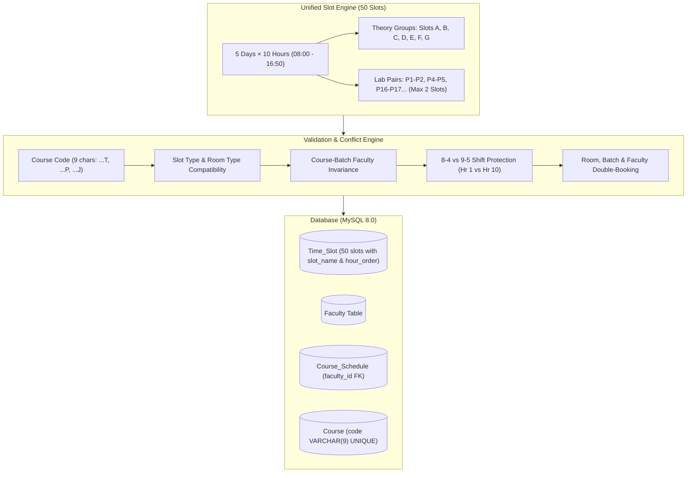

# Implementation Plan: Faculty Management & Unified Academic Scheduling

## Executive Summary
This implementation plan outlines the architecture, database schema, conflict engine, API contracts, user interface, and verification strategy for the **Faculty Management & Academic Scheduling** module in the **Classroom & Lab Utilization System (CLUS)**.

### Confirmed Requirements & Architectural Decisions:
1. **Fresh Seed Data**: Rebuild `database/seed.sql` with a clean, fully compliant dataset (Departments, Faculty, Rooms, 9-character Courses, Batches, and Schedules adhering to all new rules).
2. **Strict 9-Character Course Code Rule**: Every course code is exactly **9 alphanumeric characters**, with the 9th character designating the type:
   - `...T` = **Theory Only** (e.g. `18CSC301T`): Slots `A`–`G`, Room: `Classroom` or `Lecture Hall`.
   - `...P` = **Practical Only** (e.g. `18CSC206P`): Slots `P#`, Room: `Lab` (at most 2 consecutive slots at once).
   - `...J` = **Joint (Theory + Practical)** (e.g. `18CSC205J`): Has Theory sessions and Lab sessions (max 2 slots), handled by the **exact same instructor**.
3. **Unified Time Slot Grid (Hours 1 to 10)**: 50 active slots per week (08:00 to 16:50, excluding slots 11 & 12).
4. **Faculty 8–4 vs 9–5 Shift Rule**: If an instructor is assigned to Hour 1 (08:00–08:50) on any day, they cannot be assigned to Hour 10 (16:00–16:50) on that same day.
5. **Simultaneous Lab Allocations**: Practical sessions are booked in pairs of **at most 2 consecutive slots** (e.g. `P1–P2`, `P4–P5`), never 5 at once.
6. **Faculty Invariance & Reassignment**: A course for a batch is locked to one faculty member. If a professor leaves or resigns, schedules can be deleted and re-allocated to a new instructor.

---

## Architecture & System Design



---

## 1. Unified Time Slot Grid & Course Classification

### 1.1 Period Timings (Hours 1 to 10)
Slots 11 (04:50–05:30) and 12 (05:30–06:10) are omitted. Active periods:

| Hour | Start Time | End Time | Duration | Grid Role |
| :---: | :---: | :---: | :---: | :---: |
| **1** | `08:00:00` | `08:50:00` | 50 mins | Shift 1 Start (**First Slot**) |
| **2** | `08:50:00` | `09:40:00` | 50 mins | |
| **3** | `09:45:00` | `10:35:00` | 50 mins | (5-min break) |
| **4** | `10:40:00` | `11:30:00` | 50 mins | (5-min break) |
| **5** | `11:35:00` | `12:25:00` | 50 mins | (5-min break) |
| **6** | `12:30:00` | `13:20:00` | 50 mins | Midday transition |
| **7** | `13:25:00` | `14:15:00` | 50 mins | (5-min break) |
| **8** | `14:20:00` | `15:10:00` | 50 mins | (5-min break) |
| **9** | `15:10:00` | `16:00:00` | 50 mins | Shift 1 End (16:00) |
| **10** | `16:00:00` | `16:50:00` | 50 mins | Shift 2 End (**Last Slot**) |

### 1.2 Weekly Unified Slot Matrix (Batch 2)

| Day | Hour 1 | Hour 2 | Hour 3 | Hour 4 | Hour 5 | Hour 6 | Hour 7 | Hour 8 | Hour 9 | Hour 10 |
| :--- | :---: | :---: | :---: | :---: | :---: | :---: | :---: | :---: | :---: | :---: |
| **Day 1** | P1 | P2 | P3 | P4 | P5 | **A** | **A** | **F** | **F** | **G** |
| **Day 2** | **B** | **B** | **G** | **G** | **A** | P16 | P17 | P18 | P19 | P20 |
| **Day 3** | P21 | P22 | P23 | P24 | P25 | **C** | **C** | **A** | **D** | **B** |
| **Day 4** | **D** | **D** | **B** | **E** | **C** | P36 | P37 | P38 | P39 | P40 |
| **Day 5** | P41 | P42 | P43 | P44 | P45 | **E** | **E** | **C** | **F** | **D** |

> [!NOTE]
> - **Theory Slot Groups**: `Slot A` (4 hrs), `Slot B` (4 hrs), `Slot C` (4 hrs), `Slot D` (4 hrs), `Slot E` (3 hrs), `Slot F` (3 hrs), `Slot G` (3 hrs). Selecting a Theory Slot Group books all linked periods together in one transaction.
> - **Lab Slot Pairs**: Maximum 2 consecutive periods (e.g. `P1–P2`, `P4–P5`, `P16–P17`, `P18–P19`).

---

## 2. Database Schema Changes & Triggers

### 2.1 Update `Time_Slot` Schema
```sql
ALTER TABLE Time_Slot 
  ADD COLUMN hour_order INT NOT NULL DEFAULT 1 CHECK (hour_order BETWEEN 1 AND 10),
  ADD COLUMN slot_name VARCHAR(10) NOT NULL DEFAULT 'A',
  ADD COLUMN slot_type ENUM('Theory', 'Lab') NOT NULL DEFAULT 'Theory';
```

### 2.2 New `Faculty` Table
```sql
CREATE TABLE IF NOT EXISTS Faculty (
    faculty_id INT PRIMARY KEY,
    faculty_name VARCHAR(100) NOT NULL,
    email VARCHAR(100) NOT NULL UNIQUE,
    dept_id INT NOT NULL,
    designation ENUM('Professor', 'Associate Professor', 'Assistant Professor', 'Adjunct Lecturer') NOT NULL DEFAULT 'Assistant Professor',
    max_weekly_slots INT NOT NULL DEFAULT 16 CHECK (max_weekly_slots > 0 AND max_weekly_slots <= 30),
    FOREIGN KEY (dept_id) REFERENCES Department(dept_id) ON DELETE RESTRICT
);
```

### 2.3 `Course_Schedule` Migration
```sql
ALTER TABLE Course_Schedule ADD COLUMN faculty_id INT NULL;
ALTER TABLE Course_Schedule ADD CONSTRAINT fk_schedule_faculty 
    FOREIGN KEY (faculty_id) REFERENCES Faculty(faculty_id) ON DELETE RESTRICT;
CREATE INDEX idx_schedule_faculty ON Course_Schedule(faculty_id);
```

### 2.4 Integrity Triggers (Executing in Strict Priority Order)
1. **Trigger 1: Double-Booking Conflict (`trg_prevent_booking_conflict` & `trg_check_schedule_update`)**:
   - Checks Room Double-Booking $\rightarrow$ `Double Booking Error`.
   - Checks Batch Double-Booking $\rightarrow$ `Batch Conflict Error`.
   - Checks Faculty Double-Booking $\rightarrow$ `Double Booking Error: The faculty member is already scheduled for another class in this time slot!`.
   - Checks Room Capacity vs. Batch Size $\rightarrow$ `Capacity Error`.
2. **Trigger 2: Course Type & Room Consistency (`trg_check_course_type_consistency`)**:
   - Verifies 9th character of `Course.course_code`:
     - `'T'`: Slot must be `'Theory'`, Room must be `'Classroom'` or `'Lecture Hall'`.
     - `'P'`: Slot must be `'Lab'`, Room must be `'Lab'`.
     - `'J'`: When in Theory slot $\rightarrow$ Room is Classroom/Lecture Hall; when in Lab slot $\rightarrow$ Room is Lab.
3. **Trigger 3: 8–4 vs 9–5 Shift Rule (`trg_check_faculty_shift_conflict`)**:
   - Rejects if the faculty member is scheduled for both Hour 1 (08:00) and Hour 10 (16:00) on the same day.
   - Error: `Shift Violation Error: Faculty cannot be scheduled for both the first slot (08:00) and the last slot (16:00) on the same day!`
4. **Trigger 4: Course-Batch Faculty Invariance (`trg_check_course_batch_faculty_invariance`)**:
   - Ensures that all active schedules for a given `(course_id, batch_id)` have the exact same `faculty_id`.
   - Error: `Faculty Invariance Error: A course for a batch must be handled by the same faculty member across all scheduled sessions!`

---

## 3. Fresh Master Seed Data (`database/seed.sql`)

1. **Departments**:
   - Dept 1: `Computer Science and Engineering`
   - Dept 2: `Electronics and Communication Engineering`
2. **Rooms**:
   - `UB101` (Classroom, capacity 65)
   - `UB102` (Classroom, capacity 60)
   - `UB201` (Lecture Hall, capacity 120)
   - `LAB1` (Lab, capacity 40)
   - `LAB2` (Lab, capacity 40)
3. **Courses (9 Characters Strict)**:
   - Course 101: `18CSC205J` (Database Management Systems - Joint)
   - Course 102: `18CSC206P` (Operating Systems Lab - Practical)
   - Course 103: `18CSC301T` (Artificial Intelligence - Theory)
   - Course 201: `18ECC302T` (Digital Image Processing - Theory)
4. **Batches**:
   - Batch 201: Year 2, Sec A, 60 students (Dept 1)
   - Batch 202: Year 2, Sec B, 58 students (Dept 1)
   - Batch 203: Year 3, Sec A, 35 students (Dept 1 - suitable for labs)
   - Batch 301: Year 3, Sec A, 45 students (Dept 2)
5. **Faculty**:
   - 1001: `Dr. Alan Turing` (`alan.turing@college.edu`, Professor, Dept 1, max 16 slots)
   - 1002: `Dr. Grace Hopper` (`grace.hopper@college.edu`, Associate Professor, Dept 1, max 16 slots)
   - 1003: `Dr. Claude Shannon` (`claude.shannon@college.edu`, Professor, Dept 2, max 16 slots)
6. **Time Slots**:
   - Full 50 slots (Days 1–5, Hours 1–10) with official timings and slot names (`P1`, `A`, `B`, etc.).
7. **Schedules**:
   - Schedule 1: `18CSC205J` (Theory component), Batch 201, `UB101`, Slot 6 (Day 1 Hr 6 - Slot A), Faculty 1001.
   - Schedule 2: `18CSC206P` (Practical), Batch 203, `LAB1`, Slot 1 (Day 1 Hr 1 - Slot P1), Faculty 1002.
   - Schedule 3: `18CSC301T` (Theory), Batch 201, `UB201`, Slot 14 (Day 2 Hr 4 - Slot G), Faculty 1001.

---

## 4. Backend Endpoints & Validation Layer

### 4.1 Faculty Management Endpoints
- `GET /api/faculty`: Returns all faculty with department, designation, and current workload.
- `POST /api/faculty`: Add faculty with validation (Coordinator only).
- `PUT /api/faculty/:faculty_id`: In-place updates (Coordinator only).
- `GET /api/faculty/:faculty_id/impact`: Cascade impact before deletion.
- `DELETE /api/faculty/:faculty_id`: Protected deletion (Coordinator only).
- `GET /api/faculty/:faculty_id/timetable`: Specific weekly timetable for an instructor.

### 4.2 Scheduling Endpoints
- **`POST /api/schedules`**:
  - Accepts single slot or 2-slot lab pair (`slot_ids: [1, 2]`).
  - Supports `faculty_id`.
- **`POST /api/schedules/clubbed`**:
  - Accepts `{ course_id, batch_id, room_number, faculty_id, slot_name }`.
  - Atomically allocates all linked periods for that slot group.
- **`GET /api/departments/:dept_id/impact`**:
  - Updated to return `faculty_count` alongside courses, batches, and schedules.

### 4.3 Validation Layer (`server/validation.js`)
- `validateCourse`: Enforces regex `/^[A-Za-z0-9]{8}[TPJ]$/`.
- `validateFaculty`: Enforces positive `faculty_id`, valid email, existing department, valid designation, and `max_weekly_slots` between 1 and 30.

---

## 5. Frontend Architecture & User Interface

### 5.1 Faculty Management Tab (`FacultyList.tsx`)
- Navigation tab with `GraduationCap` icon in `DashboardLayout.tsx`.
- Workload meters (`8/16 slots [████░░░░] 50%`) with color warning thresholds.
- Edit / Delete with `CascadeDeleteModal.tsx`.

### 5.2 Timetable Matrix View Upgrade (`ScheduleView.tsx` & `TimeSlotGrid.tsx`)
- **Unified 10-Hour × 5-Day Matrix**:
  - Renders Theory slots in amber/yellow and Lab slots in emerald/green.
  - Cells display Course Code, Batch, Room, and Instructor Name with Designation chip.
- **Filter by Faculty**:
  - One-click dropdown to view a specific teacher's weekly commitments.
- **Clubbed Slot Selection**:
  - Selecting Slot `A` highlights and selects all 4 corresponding slots across the week simultaneously.
  - Lab booking allows selecting at most 2 consecutive lab periods.
- **Course Management (`CourseList.tsx`)**:
  - Course code input configured for 9 characters with auto-suggested suffix selector (`Theory [T]`, `Practical [P]`, `Joint [J]`).

---

## 6. Execution Phases & Verification

| Phase | Milestone | Deliverables |
| :--- | :--- | :--- |
| **Phase 1: DB Migration & Seed** | Database Upgrade | Execute SQL patch for `Time_Slot`, `Faculty`, triggers, and seed `seed.sql`. |
| **Phase 2: Backend APIs** | Server & Validation | Implement `validateFaculty`, 9-char `validateCourse`, `/api/faculty` CRUD, and `/api/schedules/clubbed`. |
| **Phase 3: Automated Test Suite** | Verification Suite | Create `test_faculty.cjs`, update `test_sprint2.cjs` and `test_sprint3.cjs` to align with fresh seed. All tests pass (100%). |
| **Phase 4: Frontend Integration** | UI Views & Components | Create `FacultyList.tsx`, update `DashboardLayout.tsx`, `ScheduleView.tsx`, `TimeSlotGrid.tsx`, `CourseList.tsx`, and `api.ts`. |
| **Phase 5: Full Regression Audit** | End-to-End Verification | Browser E2E verification, `npm run typecheck` (0 errors), all test suites pass. |
