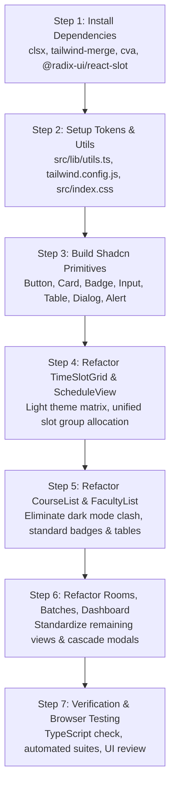

# Implementation Plan: Complete UI Migration to Shadcn UI Components

## 1. Executive Summary & Root Cause Analysis

### Current Visual Problems
1. **Style & Theme Collision**: The application is currently experiencing a severe theme clash. The top layout and navigation use light gray (`bg-gray-50/50`, `bg-white`, `border-gray-200`), whereas components like [`CourseList.tsx`](file:///d:/Shahzaad/Projects/College/classroomUtilOpSystem/src/components/CourseList.tsx) and the [`TimeSlotGrid.tsx`](file:///d:/Shahzaad/Projects/College/classroomUtilOpSystem/src/components/TimeSlotGrid.tsx) popover were built with hardcoded dark slate (`bg-slate-900`, `border-slate-800`, white text). This produces an uncoordinated, fragmented experience when dark components float over light pages.
2. **Ad-Hoc Controls**: Form inputs, select dropdowns, buttons, and tables each use different border radii, padding, font weights, and focus rings across different views.
3. **Mismatched Modals**: Modals in `FacultyList`, `ScheduleView`, and `CascadeDeleteModal` have differing backdrop blurs, header borders, and button styles.

### Target Vision (Shadcn UI Standard)
- **Unified Design System**: A cohesive, modern, and accessible **Zinc/Slate design system** using standard Shadcn CSS variables and design tokens.
- **Consistent Light-Mode Master Palette**: Clean white cards (`bg-card`), subtle borders (`border-border`), crisp typography with `Inter`, consistent rounded corners (`rounded-xl`), and accessible focus rings.
- **Dedicated Slot System Accents**: Curated, harmonious pastel accents for academic types:
  - **Theory (A–G)**: Soft amber/orange tones (`bg-amber-50`, `text-amber-800`, `border-amber-200`).
  - **Lab / Practical (P1–P50)**: Clean emerald/teal tones (`bg-emerald-50`, `text-emerald-800`, `border-emerald-200`).
  - **Joint Courses (J)**: Distinctive purple/indigo tones (`bg-purple-50`, `text-purple-800`, `border-purple-200`).

---

## 2. Technical Architecture & Dependencies

### 2.1 Dependencies to Install
We will install the core utilities and Radix UI primitives that power Shadcn components:
```bash
npm install clsx tailwind-merge class-variance-authority @radix-ui/react-slot
```

### 2.2 Core Utility: `src/lib/utils.ts`
Establish the canonical `cn()` helper combining `clsx` and `tailwind-merge`:
```typescript
import { clsx, type ClassValue } from 'clsx';
import { twMerge } from 'tailwind-merge';

export function cn(...inputs: ClassValue[]) {
  return twMerge(clsx(inputs));
}
```

### 2.3 Tailwind & CSS Tokens (`tailwind.config.js` & `src/index.css`)
Configure standard Shadcn HSL CSS variables supporting clean card surfaces, borders, and accessible foregrounds:
- `--background`: `0 0% 100%` (white)
- `--foreground`: `240 10% 3.9%` (slate-950)
- `--card`: `0 0% 100%` (white)
- `--card-foreground`: `240 10% 3.9%`
- `--popover`: `0 0% 100%`
- `--primary`: `240 5.9% 10%` / Brand blue `221.2 83.2% 53.3%`
- `--secondary`: `240 4.8% 95.9%` (slate-100)
- `--muted`: `240 4.8% 95.9%`
- `--muted-foreground`: `240 3.8% 46.1%` (slate-500)
- `--accent`: `240 4.8% 95.9%`
- `--destructive`: `0 84.2% 60.2%`
- `--border`: `240 5.9% 90%` (slate-200)
- `--input`: `240 5.9% 90%`
- `--ring`: `240 5.9% 10%`
- `--radius`: `0.75rem` (12px)

---

## 3. Reusable Shadcn UI Primitives (`src/components/ui/`)

We will build the standard Shadcn UI components under [`src/components/ui/`](file:///d:/Shahzaad/Projects/College/classroomUtilOpSystem/src/components/ui/):

| Component File | Exported Elements | Key Features |
| :--- | :--- | :--- |
| **`button.tsx`** | `Button`, `buttonVariants` | CVA variants: `default`, `destructive`, `outline`, `secondary`, `ghost`, `link`. Sizes: `sm`, `default`, `lg`, `icon`. Fully typed with `asChild` slot support. |
| **`card.tsx`** | `Card`, `CardHeader`, `CardTitle`, `CardDescription`, `CardContent`, `CardFooter` | Standard Shadcn border, background, and shadow tokens for consistent elevated panels. |
| **`badge.tsx`** | `Badge`, `badgeVariants` | Variants: `default`, `secondary`, `destructive`, `outline`, `theory`, `lab`, `joint`. |
| **`input.tsx`** | `Input` | Standard height, padding, subtle border, smooth focus ring, and disabled states. |
| **`label.tsx`** | `Label` | Accessible label with consistent text size and font weight. |
| **`table.tsx`** | `Table`, `TableHeader`, `TableBody`, `TableHead`, `TableRow`, `TableCell` | Clean typography, subtle bottom borders, hover row highlights, and responsive container. |
| **`dialog.tsx`** | `Dialog`, `DialogTrigger`, `DialogContent`, `DialogHeader`, `DialogFooter`, `DialogTitle`, `DialogDescription` | Accessible modal dialog with backdrop blur, smooth scale-in animations, and escape/outside-click listeners. |
| **`alert.tsx`** | `Alert`, `AlertTitle`, `AlertDescription` | Standard alerts for error, warning, and success notifications. |
| **`tabs.tsx`** | `Tabs`, `TabsList`, `TabsTrigger`, `TabsContent` | Accessible tab switcher with subtle background pill and active shadow. |

---

## 4. View-by-View Refactoring Plan

### 4.1 Master Timetable Grid ([`TimeSlotGrid.tsx`](file:///d:/Shahzaad/Projects/College/classroomUtilOpSystem/src/components/TimeSlotGrid.tsx))
- **Current State**: Hardcoded dark slate panel (`bg-slate-900 border-slate-800`), conflicting with the light application theme.
- **Refactoring**:
  - Convert to a clean, crisp **Shadcn Card** surface (`bg-card border-border shadow-lg`).
  - Period Headers (`H1`–`H10`): Styled with clean `bg-muted/50`, `text-slate-700` and mono timing subtitles (`08:00`).
  - Day Headers (`Mon`–`Fri`): Crisp badges with subtle borders.
  - **Theory Slot Cells (`A`–`G`)**: Light amber styling (`bg-amber-50/80 border-amber-200/80 text-amber-900 hover:bg-amber-100 hover:border-amber-300`).
  - **Lab Slot Cells (`P1`–`P50`)**: Light emerald styling (`bg-emerald-50/80 border-emerald-200/80 text-emerald-900 hover:bg-emerald-100 hover:border-emerald-300`).
  - **Selected State**: High-contrast, elegant Shadcn primary badge (`bg-primary text-primary-foreground shadow-md ring-2 ring-primary/20 scale-[1.03]`).
  - **Booked State**: Muted with diagonal slash or subtle gray fill with clear tooltip.

### 4.2 Master Scheduling & Allocation ([`ScheduleView.tsx`](file:///d:/Shahzaad/Projects/College/classroomUtilOpSystem/src/components/ScheduleView.tsx))
- Use `<Card>` and `<CardHeader>` for the allocation form and timetable container.
- Use `<Input>`, `<Select>`, and `<Label>` for form fields.
- Use `<Badge>` for slot names (`Slot A (Theory)` / `Slot P1 (Lab)`).
- Replace the legacy custom table with `<Table>`, `<TableHeader>`, and `<TableRow>`.
- Use `<Dialog>` for the Edit Schedule modal with standardized action buttons (`<Button variant="outline">` and `<Button>`).

### 4.3 Course Catalog ([`CourseList.tsx`](file:///d:/Shahzaad/Projects/College/classroomUtilOpSystem/src/components/CourseList.tsx))
- **Current State**: Full dark page (`bg-slate-900/80 text-white`).
- **Refactoring**:
  - Replace dark cards with clean Shadcn `<Card>` components.
  - Display course code in monospace font with `<Badge variant="theory">` (`T`), `<Badge variant="lab">` (`P`), and `<Badge variant="joint">` (`J`).
  - Standardize Add Course modal using `<Dialog>`, `<Input>`, and `<Button>`.

### 4.4 Faculty Management ([`FacultyList.tsx`](file:///d:/Shahzaad/Projects/College/classroomUtilOpSystem/src/components/FacultyList.tsx))
- Wrap the workload statistics in Shadcn `<Card>` metrics.
- Standardize the faculty roster with `<Table>`.
- Workload meters: Use clean Shadcn progress bars with subtle percentage indicators.
- Standardize Add/Edit Faculty and Faculty Timetable modals with `<Dialog>`.

### 4.5 Room Inventory & Batches ([`RoomList.tsx`](file:///d:/Shahzaad/Projects/College/classroomUtilOpSystem/src/components/RoomList.tsx), [`BatchList.tsx`](file:///d:/Shahzaad/Projects/College/classroomUtilOpSystem/src/components/BatchList.tsx), [`DepartmentList.tsx`](file:///d:/Shahzaad/Projects/College/classroomUtilOpSystem/src/components/DepartmentList.tsx))
- Standardize search bars with `<Input>`.
- Replace legacy cards and tables with Shadcn `<Card>` and `<Table>`.
- Integrate `<CascadeDeleteModal>` with `<Dialog>` and `<Alert variant="destructive">`.

### 4.6 Navigation & Shell ([`DashboardLayout.tsx`](file:///d:/Shahzaad/Projects/College/classroomUtilOpSystem/src/components/DashboardLayout.tsx))
- Top Navigation: Refactor tab list into Shadcn `<TabsList>` or clean pill navigation with consistent active shadows.
- Role Badges: Coordinator (`<Badge variant="secondary">` with purple tint), Viewer (`<Badge variant="outline">`).
- Staff Account Provision Modal: Standardize with `<Dialog>`.

---

## 5. Implementation Steps & Sequencing



---

## 6. Verification Plan & Acceptance Criteria

1. **Compilation & Type Safety**:
   - `npx tsc --noEmit` must pass with **0 errors**.
2. **Automated Test Suites**:
   - `node test_faculty.cjs`: 23/23 tests pass.
   - `node test_sprint4.cjs`: 17/17 tests pass.
   - `node test_sprint3.cjs`: 20/20 tests pass.
   - `node test_sprint2.cjs`: 20/20 tests pass.
3. **Visual & UX Acceptance (Browser Validation)**:
   - Zero dark-mode clash between modals and background pages.
   - Clean, professional typography, borders, and input focus states.
   - TimeSlotGrid renders cleanly in light mode with crystal-clear theory/lab accents.
   - Clicking Slot A continues to highlight all A slots and schedule the whole group atomically.
