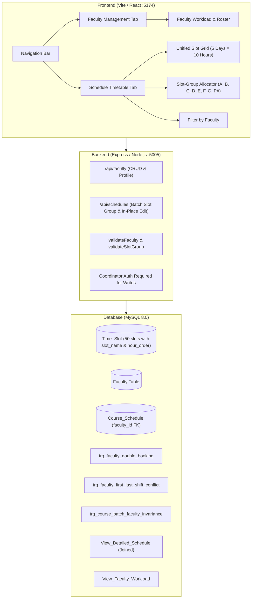

# Implementation Plan: Faculty Management & Unified Slot-Based Scheduling

## Executive Summary
This implementation plan outlines the architecture, database schema, conflict engine, API contracts, and user interface for the **Faculty Management & Academic Scheduling** module in the **Classroom & Lab Utilization System (CLUS)**.

It incorporates the university **Unified Time Table (B.Tech / M.Tech Batch 2)** specification, including:
1. **New 50-Slot Timetable Grid (Hours 1 to 10)** matching the official timetable hours (08:00 to 16:50, excluding slots 11 & 12).
2. **Clubbed / Named Slot Scheduling Engine**: Theory slot groups (Slots `A`, `B`, `C`, `D`, `E`, `F`, `G`) and Lab slot groups (`P1–P5`, `P16–P20`, etc.). Selecting a slot name schedules all linked hours across the week together.
3. **Faculty 8–4 vs 9–5 Shift Rule (First Slot vs Last Slot Protection)**: If a faculty member is assigned to the first period of any day (08:00–08:50), they cannot be assigned to the last period (16:00–16:50) on that same day.
4. **Course-Batch Faculty Invariance Rule**: A course for a specific batch must be handled by the same faculty member across all scheduled sessions.

---

## Architecture & System Design



---

## 1. Unified Time Slot Grid & Clubbed Slot Specifications

### 1.1 Period Timing (Hours 1 to 10)
Slots 11 (04:50–05:30) and 12 (05:30–06:10) are omitted. The 10 active periods per day are:

| Hour | Start Time | End Time | Duration | Notes |
| :---: | :---: | :---: | :---: | :--- |
| **1** | `08:00:00` | `08:50:00` | 50 mins | **First Slot** of the day (Shift 1 start) |
| **2** | `08:50:00` | `09:40:00` | 50 mins | |
| **3** | `09:45:00` | `10:35:00` | 50 mins | 5-min passing break |
| **4** | `10:40:00` | `11:30:00` | 50 mins | 5-min passing break |
| **5** | `11:35:00` | `12:25:00` | 50 mins | 5-min passing break |
| **6** | `12:30:00` | `13:20:00` | 50 mins | Midday transition |
| **7** | `13:25:00` | `14:15:00` | 50 mins | 5-min passing break |
| **8** | `14:20:00` | `15:10:00` | 50 mins | 5-min passing break |
| **9** | `15:10:00` | `16:00:00` | 50 mins | Shift 1 ends at 16:00 |
| **10** | `16:00:00` | `16:50:00` | 50 mins | **Last Slot** of the day (Shift 2 end) |

### 1.2 Weekly Slot Mapping Matrix (Unified B.Tech / M.Tech Batch 2)

| Day | Hour 1 | Hour 2 | Hour 3 | Hour 4 | Hour 5 | Hour 6 | Hour 7 | Hour 8 | Hour 9 | Hour 10 |
| :--- | :---: | :---: | :---: | :---: | :---: | :---: | :---: | :---: | :---: | :---: |
| **Day 1** | P1 | P2/X | P3/X | P4 | P5 | **A** | **A** | **F** | **F** | **G** |
| **Day 2** | **B** | **B/X** | **G/X** | **G** | **A** | P16 | P17 | P18 | P19 | P20 |
| **Day 3** | P21 | P22/X | P23/X | P24 | P25 | **C** | **C** | **A** | **D** | **B** |
| **Day 4** | **D** | **D/X** | **B/X** | **E** | **C** | P36 | P37 | P38 | P39 | P40 |
| **Day 5** | P41 | P42/X | P43/X | P44 | P45 | **E** | **E** | **C** | **F** | **D** |

> [!NOTE]
> **Theory Slot Groups**:
> - **Slot A**: Day 1 (H6, H7), Day 2 (H5), Day 3 (H8) *(4 hrs/week)*
> - **Slot B**: Day 2 (H1, H2), Day 3 (H10), Day 4 (H3) *(4 hrs/week)*
> - **Slot C**: Day 3 (H6, H7), Day 4 (H5), Day 5 (H8) *(4 hrs/week)*
> - **Slot D**: Day 3 (H9), Day 4 (H1, H2), Day 5 (H10) *(4 hrs/week)*
> - **Slot E**: Day 4 (H4), Day 5 (H6, H7) *(3 hrs/week)*
> - **Slot F**: Day 1 (H8, H9), Day 5 (H9) *(3 hrs/week)*
> - **Slot G**: Day 1 (H10), Day 2 (H3, H4) *(3 hrs/week)*
>
> **Lab Slot Blocks**:
> - Day 1 Morning: `P1–P5` (Hours 1–5)
> - Day 2 Afternoon: `P16–P20` (Hours 6–10)
> - Day 3 Morning: `P21–P25` (Hours 1–5)
> - Day 4 Afternoon: `P36–P40` (Hours 6–10)
> - Day 5 Morning: `P41–P45` (Hours 1–5)

---

## 2. Database Schema & Hard Integrity Constraints

### 2.1 Update `Time_Slot` Schema
Add `hour_order` (1–10) and `slot_name` (e.g. `'A'`, `'B'`, `'P1'`, etc.) to `Time_Slot`:
```sql
ALTER TABLE Time_Slot 
  ADD COLUMN hour_order INT NOT NULL DEFAULT 1 CHECK (hour_order BETWEEN 1 AND 10),
  ADD COLUMN slot_name VARCHAR(10) NOT NULL DEFAULT 'A';
```

### 2.2 `Faculty` Table Definition
```sql
CREATE TABLE IF NOT EXISTS Faculty (
    faculty_id INT PRIMARY KEY,
    faculty_name VARCHAR(100) NOT NULL,
    email VARCHAR(100) NOT NULL UNIQUE,
    dept_id INT NOT NULL,
    designation ENUM('Professor', 'Associate Professor', 'Assistant Professor', 'Adjunct Lecturer') NOT NULL DEFAULT 'Assistant Professor',
    max_weekly_slots INT NOT NULL DEFAULT 16 CHECK (max_weekly_slots > 0 AND max_weekly_slots <= 30),
    FOREIGN KEY (dept_id) REFERENCES Department(dept_id) ON DELETE RESTRICT
);
```

### 2.3 `Course_Schedule` Migration
```sql
ALTER TABLE Course_Schedule ADD COLUMN faculty_id INT NULL;
ALTER TABLE Course_Schedule ADD CONSTRAINT fk_schedule_faculty 
    FOREIGN KEY (faculty_id) REFERENCES Faculty(faculty_id) ON DELETE RESTRICT;
CREATE INDEX idx_schedule_faculty ON Course_Schedule(faculty_id);
```

### 2.4 Integrity Triggers

#### Trigger 1: Faculty Double-Booking Prevention (`trg_check_faculty_double_booking`)
- Enforced on both `BEFORE INSERT` and `BEFORE UPDATE`.
- Rejects if `faculty_id` is already scheduled in any room at `NEW.slot_id`.
- Error: `Double Booking Error: The faculty member is already scheduled for another class in this time slot!`

#### Trigger 2: 8–4 vs 9–5 Shift Rule (`trg_check_faculty_shift_conflict`)
- Runs `BEFORE INSERT` and `BEFORE UPDATE` on `Course_Schedule`.
- If `NEW.slot_id` corresponds to **Hour 1** on Day $D$, verifies that the faculty member does NOT have any class at **Hour 10** on Day $D$.
- If `NEW.slot_id` corresponds to **Hour 10** on Day $D$, verifies that the faculty member does NOT have any class at **Hour 1** on Day $D$.
- Error: `Shift Violation Error: Faculty cannot be scheduled for both the first slot (08:00) and the last slot (16:00) on the same day!`

#### Trigger 3: Course-Batch Faculty Invariance (`trg_check_course_batch_faculty_invariance`)
- Runs `BEFORE INSERT` and `BEFORE UPDATE` on `Course_Schedule`.
- Checks if another schedule already exists for the same `(course_id, batch_id)`.
- If an existing schedule has `faculty_id IS NOT NULL` and `NEW.faculty_id != existing_faculty_id`, rejects the transaction.
- Error: `Faculty Invariance Error: A course for a batch must be handled by the same faculty member across all scheduled sessions!`

---

## 3. Backend API Endpoints & Business Logic

### 3.1 Faculty Management Endpoints
- `GET /api/faculty`: Returns all faculty with department name, designation, total weekly slots assigned, and utilization rate.
- `POST /api/faculty`: Adds faculty with validation (Coordinator only).
- `PUT /api/faculty/:faculty_id`: Updates faculty details / workload limit (Coordinator only).
- `GET /api/faculty/:faculty_id/impact`: Cascade impact check (returns count of active schedules before deletion).
- `DELETE /api/faculty/:faculty_id`: Deletes faculty (blocked if active schedules exist).
- `GET /api/faculty/:faculty_id/timetable`: Returns the weekly timetable grid for that specific teacher.

### 3.2 Clubbed Slot Group Scheduling Endpoint
Add `POST /api/schedules/clubbed`:
- Accepts: `{ course_id, batch_id, room_number, faculty_id, slot_name }`.
- Fetches all `slot_id`s corresponding to `slot_name` (e.g. all 4 slots for Slot `A`).
- Wraps insertions in a **single database transaction**:
  - Automatically validates room capacity, batch conflicts, faculty double booking, and the 8–4 vs 9–5 shift rule.
  - If any conflict occurs, rolls back cleanly and returns the specific conflicting slot to the user.

---

## 4. Frontend Architecture & User Experience

### 4.1 Faculty Management View (`FacultyList.tsx`)
- Placed on the navigation bar as the **Faculty** tab.
- **KPI Metrics**: Total Faculty, Department Distribution, Average Teaching Hours, Saturated Faculty (>85% load).
- **Roster Table**:
  - Name & Email, Department badge, Designation chip.
  - **Workload Bar**: Progress bar showing `assigned / max_weekly_slots` with color warnings (green < 70%, amber 70–90%, red > 90%).
  - Action buttons: View Timetable, Edit, Delete (with `CascadeDeleteModal`).

### 4.2 Timetable Matrix View Upgrade (`ScheduleView.tsx`)
- **Unified 10-Hour × 5-Day Grid**:
  - Renders the exact matrix layout matching the official B.Tech/M.Tech timetable.
  - Visual indicators for **Theory Slots** (yellow background) and **Lab Slots** (green background).
  - Displays Course Code, Batch, Room, and Instructor Name with designation badge in each cell.
- **Filter by Faculty**:
  - Dropdown to isolate and view any instructor's weekly schedule with one click.
- **Clubbed Slot Allocation Modal**:
  - Radio/Select to choose **Slot Group** (e.g. `Slot A (4 hrs)`, `Slot B (4 hrs)`, `Slot C (4 hrs)`, `Lab Day 1 (5 hrs)`).
  - Automatically populates the assigned faculty if that course and batch were previously scheduled.
  - Immediate client-side alert if assigning to a slot group violates the instructor's 8–4 vs 9–5 shift rule.

---

## 5. Verification & Testing Strategy

### 5.1 Automated Test Suite (`test_faculty.cjs`)
1. **Grid Verification**: Verify all 50 slots (Days 1–5, Hours 1–10) match correct start/end times and slot names.
2. **Clubbed Slot Scheduling**: Schedule `Slot A` and verify that all 4 corresponding schedule records are created in one operation.
3. **Double-Booking Prevention**: Attempt to allocate the same faculty in two different rooms at the same slot $\rightarrow$ expect `400 Double Booking Error`.
4. **8–4 vs 9–5 Shift Enforcement**:
   - Assign faculty to Day 1 Hour 1 (08:00–08:50).
   - Attempt to assign same faculty to Day 1 Hour 10 (16:00–16:50) $\rightarrow$ expect `400 Shift Violation Error`.
   - Verify that Day 1 Hour 9 (15:10–16:00) is permitted (within the 8:00–16:00 window).
5. **Course-Batch Faculty Invariance**:
   - Assign Teacher X to Course 101 for Batch 201 on Day 1.
   - Attempt to assign Teacher Y to Course 101 for Batch 201 on Day 2 $\rightarrow$ expect `400 Faculty Invariance Error`.
6. **Regression Suite**: Re-run `test_sprint2.cjs`, `test_sprint3.cjs`, and `test_sprint4.cjs` to confirm zero regressions across prior modules.
7. **TypeScript Typecheck**: Ensure `npm run typecheck` passes with 0 errors.
